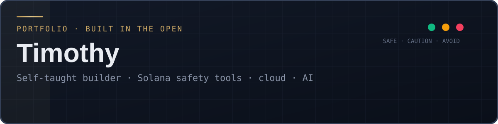

**Portfolio site: [timothymycompc.github.io](https://timothymycompc.github.io)**

I build **safety tools for AI agents and people who move money on Solana**, and I test them honestly. Since August 2026,
in my off-work hours and mostly from a phone, I've shipped a production API on Google Cloud, two free public safety websites, five Telegram bots, an
ecosystem-wide bug investigation that got fixes merged in other teams' code, and a public, fully reproducible trading
research project.

## Featured work
| Project | What it is | Highlights |
|---|---|---|
| **[Solana Pulse](https://github.com/Timothymycompc/solana-pulse-ai-agent-gateway)** | Safety gateway for AI agents: "is this transaction what I asked for? is this token a known trap?" Plain HTTP + MCP, paid per call with x402 (USDC) | Live on Cloud Run · public benchmark 9/9 attack cases, 0 false alarms · 200/200 real transactions checked with exact fees · official MCP registry + 4 curated lists (all merged) |
| **[Drain Check](https://drain-check-1021990235790.us-central1.run.app)** | Free "was my wallet drained?" website: paste a wallet, a transaction ID or a Solscan link and see the biggest move, where the money went, and which drain patterns were found (lookalike dust, sweeper wallets, someone else paying the fees) | Built Nov 10–11 on Solana Pulse data, every fact sourced or marked unknown · fixed after a real case where an 83.9 SOL send was hidden behind dust spam · from a transaction ID it asks which wallet is yours, then traces it |
| **[Rug Check](https://rug-check-1021990235790.us-central1.run.app)** | Free "is this token a rug pull?" website, sister site to Drain Check on the same deploy: known rug traps plus who traded it from launch (insider check) | Paste a token or a Solscan link · verdict first, insider check loads after |
| **Version 1 transaction investigation** | Found that ~35–44% of Solana swaps had moved to a transaction format many apps couldn't read | Measured it, fixed my own API the same night, filed 34 reports; **fixes merged in 7 projects** (incl. elizaOS, rotki, Agent402, Chainflip), plus 3 fix PRs of my own. Nov 11: tested on mainnet that `@solana/web3.js` below 1.99.0 can't read version 1 even with the right setting, posted corrections on my own reports, and restarted the reports from a daily cloud job (10 a day, each checked against the repo's live code) |
| **[Base Pulse](https://github.com/Timothymycompc/base-pulse)** | The same safety layer for agents paying on Base (EVM): recipient checks, approvals, sanctions list, x402 checks | Live since Oct 14 |
| **[CashOut Check](https://github.com/Timothymycompc/cashout-check)** | Paste an online casino, play-to-earn app or deposit wallet, get a plain scam-risk answer with sources | Built from real scam investigations; tests use recorded real cases |
| **Telegram bots** | Public Pulse checker, a firewood-buyer finder (free public data), grant/bounty scanner, freelance job assistant | 2 live, 3 built |
| **[Trading Review](https://github.com/Timothymycompc/trading-review)** | Honest backtests of memecoin bots, stock rules and forex systems — all code and raw data public | Locked test years, hidden data, tests committed before they ran; reports what *failed* |
| **[Dev Log](https://github.com/Timothymycompc/dev-log)** | The full story: what I built, what broke, how I fixed it, what I learned | Timeline, lessons, security practices |

## Latest bug reports and fixes
<!-- latest:start -->
| Date | Issue | What it's about | State |
|---|---|---|---|
| 2026-11-11 | [ibonon/Sigui#5](https://github.com/ibonon/Sigui/issues/5) | solana_oracle.monitor_slot sees no transactions in most blocks | open |
| 2026-11-11 | [AIQnetLab/QNet-Blockchain#3](https://github.com/AIQnetLab/QNet-Blockchain/issues/3) | activation bridge can't see burn transactions sent as version 1 | open |
| 2026-11-11 | [arbincept/meme-intelligence-onchain#2](https://github.com/arbincept/meme-intelligence-onchain/issues/2) | solana_rpc.get_transaction returns None for every version 1 transaction | open |
| 2026-11-11 | [SharesDAO/Arbitrage-Trader#2](https://github.com/SharesDAO/Arbitrage-Trader/issues/2) | one version 1 deposit makes get_sol_txs return no transactions at all | open |
| 2026-11-11 | [JamesonRGrieve/ServerFramework#284](https://github.com/JamesonRGrieve/ServerFramework/issues/284) | PRV_Solana transaction lookup fails for version 1 transactions | open |
| 2026-11-11 | [redactedmeme/swarm#26](https://github.com/redactedmeme/swarm/issues/26) | arb-keeper: check the Jupiter transaction before _sign_tx signs it | open |
| 2026-11-11 | [nexgent-ai-org/nexgent-open-source-trading-engine#57](https://github.com/nexgent-ai-org/nexgent-open-source-trading-engine/issues/57) | Jupiter swap provider: check the swap transaction before signTransaction | open |
| 2026-11-11 | [motebit/motebit#1253](https://github.com/motebit/motebit/issues/1253) | wallet-solana: check Jupiter swap transactions before the agent signs them | open |

Updated automatically from GitHub: 61 issues filed, 9 projects fixed a bug I reported, 5 merged PRs.
<!-- latest:end -->

## Time invested
**≈ 256 hours from Aug 30 to Nov 11, 2026**, about six and a half full work weeks, all in off-work hours. Since Oct 10 I've worked on
this **every day (33 of 33), about 7 hours a day.**

| Project | ≈ Hours |
|---|---|
| Solana Pulse | ~170 |
| Trade Desk (memecoins) | ~40 |
| V1 Ready + bug reports | ~20 |
| Phone setup + AI tooling | ~17 |
| CashOut Check | ~10 |
| Base Pulse | ~9 |
| Freelance tools (Gig Bidder, gigs) | ~6 |
| Night Desk (stocks + forex) | ~5 |
| Firewood Buyers | ~4 |
| Dev log + portfolio | ~5 |
| Rug Check + Drain Check, Money Scan, Clip Drop | ~3 |
| **Total** | **≈ 256** (rows add to ~289 because some sessions overlap) |

Estimated from git commit sessions and AI-session history ([method + script](https://github.com/Timothymycompc/dev-log#time-spent-estimated)). Per-project rows overlap slightly where sessions ran in parallel.

## Strengths
- **I ship complete systems.** API, database, payments, scheduled jobs, alerts, deploys with one-command rollback — on
  Google Cloud Run, Cloud SQL, Scheduler, Secret Manager and Cloud Build.
- **I measure instead of claiming.** Recorded real-world test cases, public benchmarks, track records that include misses,
  and backtests built to catch my own luck.
- **I find real problems in real data.** The version 1 transaction bug came from reading mainnet blocks, not from an issue
  someone else filed.
- **Security-minded with money.** Secrets only in Secret Manager, hard spending limits and kill switches on wallets,
  check-before-sign on every transaction, no IP addresses stored. ([how](https://github.com/Timothymycompc/dev-log/blob/master/security.md))
- **I get a lot out of AI tools, and I check their work.** Claude Code and Gemini as pair-programmer and reviewer, with
  tests and numbers as the referee. ([what I learned](https://github.com/Timothymycompc/dev-log/blob/master/apis-cloud-ai.md))
- **Resourceful.** Most of this was built on a phone, with free data sources wherever possible.

## Still working on
- **Writing code without AI help.** I direct and review AI-written code well; my hand-coding fundamentals are what I'm
  building up next.
- **Getting real users.** Pulse has handled 180k+ calls, but those were directories, monitors and tests, not customers.
  Distribution is the skill I'm learning now. Since Nov 11 I'm offering agent teams a free month of pre-sign checks,
  each message pointing at the exact line where their agent signs a transaction without checking it.
- **Finishing before starting.** A few bots are built but not yet deployed, so I'm working to one project at a time.

## Tools I use
`TypeScript` `Node.js / Express` `Python` `PostgreSQL` `Google Cloud Run · Cloud SQL · Scheduler · Secret Manager · Cloud Build · Storage`
`Solana (web3.js, kit, Jupiter, Helius)` `Base / EVM` `MCP` `x402 payments` `Telegram Bot API` `GitHub Actions (OIDC publishing)`
`Claude Code` `Gemini / Antigravity`

Every number on this page comes from real data and the linked repos. Nothing here is financial advice.
