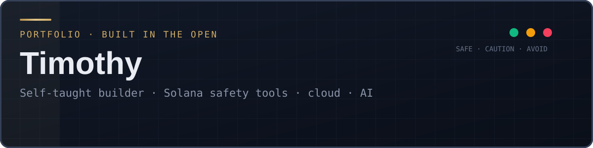

<p align="center"></p>

<p align="center">


[](https://glama.ai/mcp/connectors/io.github.Timothymycompc/solana-pulse-gateway)
[](https://mcptry.com/servers/io.github.Timothymycompc/solana-pulse-gateway)

</p>

**Portfolio site: [timothymycompc.github.io](https://timothymycompc.github.io)**

I build **safety tools for AI agents and people who move money on Solana**, and I test them honestly. Since August 2026,
in my off-work hours and mostly from a phone, I've shipped a production API on Google Cloud, two free public safety websites, Telegram bots, an
ecosystem-wide bug investigation that got fixes merged in other teams' code, and a public, fully reproducible trading
research project.

## Install Solana Pulse
Check a Solana transaction before your agent signs it. 25 free calls a day per tool, no key needed.

[](https://www.npmjs.com/package/solana-pulse)
[](https://pypi.org/project/solana-pulse/)
[](https://www.npmjs.com/package/agentkit-solana-pulse)
[](https://www.npmjs.com/package/elizaos-plugin-solana-pulse)
[](https://www.npmjs.com/package/solana-agent-kit-plugin-pulse)

| For | Install |
|---|---|
| JavaScript / TypeScript | `npm install solana-pulse` |
| Python | `pip install solana-pulse` |
| Coinbase AgentKit | `npm install agentkit-solana-pulse` |
| elizaOS | `npm install elizaos-plugin-solana-pulse` |
| Solana Agent Kit (SendAI) | `npm install solana-agent-kit-plugin-pulse` |
| Any MCP client (Claude, Cursor…) | `https://solana-pulse-gateway-1021990235790.us-central1.run.app/mcp` |

```js
import { checkBeforeSign } from "solana-pulse";
await checkBeforeSign(tx); // throws unless Pulse says the transaction is OK
```

```python
from solana_pulse import check_before_sign
check_before_sign(tx)  # raises unless Pulse says the transaction is OK
```

## Featured work
| Project | What it is | Highlights |
|---|---|---|
| **[Solana Pulse](https://github.com/Timothymycompc/solana-pulse-ai-agent-gateway)** | Safety gateway for AI agents: "is this transaction what I asked for? is this token a known trap?" Plain HTTP + MCP, paid per call with x402 (USDC). One-line installs: `npm install solana-pulse`, `pip install solana-pulse`, plus packages for Coinbase AgentKit, elizaOS and Solana Agent Kit | Live on Cloud Run · public benchmark 9/9 attack cases, 0 false alarms · 200/200 real transactions checked with exact fees · official MCP registry + 4 curated lists (all merged) |
| **[Drain Check](https://drain-check-1021990235790.us-central1.run.app)** | Free "was my wallet drained?" website: paste a wallet, a transaction ID or a Solscan link and see the biggest move, where the money went, and which drain patterns were found (lookalike dust, sweeper wallets, someone else paying the fees) | Built Nov 10–11 on Solana Pulse data, every fact sourced or marked unknown · fixed after a real case where an 83.9 SOL send was hidden behind dust spam · from a transaction ID it asks which wallet is yours, then traces it |
| **[Rug Check](https://rug-check-1021990235790.us-central1.run.app)** | Free "is this token a rug pull?" website, sister site to Drain Check on the same deploy: known rug traps plus who traded it from launch (insider check) | Paste a token or a Solscan link · verdict first, insider check loads after |
| **Version 1 transaction investigation** | Found that ~35–44% of Solana swaps had moved to a transaction format many apps couldn't read | Measured it, fixed my own API the same night, filed 45 reports; **fixes merged in 9 projects** (incl. elizaOS, rotki, Agent402, Chainflip, QuickNode), plus 3 fix PRs of my own. Nov 11: tested on mainnet that `@solana/web3.js` below 1.99.0 can't read version 1 even with the right setting, posted corrections on my own reports, and restarted the reports from a daily cloud job (10 a day, each checked against the repo's live code); paused Nov 12 to focus on direct offers to teams that sign API-built transactions |
| **[Base Pulse](https://github.com/Timothymycompc/base-pulse)** | The same safety layer for agents paying on Base (EVM): recipient checks, approvals, sanctions list, x402 checks | Live since Oct 14 |
| **[CashOut Check](https://github.com/Timothymycompc/cashout-check)** | Paste an online casino, play-to-earn app or deposit wallet, get a plain scam-risk answer with sources | Built from real scam investigations; tests use recorded real cases |
| **[Pulse Safety Desk](https://github.com/Timothymycompc/pulse-safety-desk)** | Entry for Cognizant's Open Agentic Web Challenge: an agent desk that checks wallets, tokens and transactions with Solana Pulse before anything is signed | Live, public repo, live tests pass |
| **Security lab (learning)** | Kali NetHunter on an unrooted phone, driven by Claude Code; deliberately broken practice APIs (IDOR, price tampering, no rate limit) attacked and then fixed | Own targets and legal labs only; next: web/API bug bounties inside each program's written scope |
| **Telegram bots** | Public Solana Pulse checker | Live |
| **[Trading Review](https://github.com/Timothymycompc/trading-review)** | Honest backtests of memecoin bots, stock rules and forex systems — all code and raw data public | Locked test years, hidden data, tests committed before they ran; reports what *failed* |
| **[Dev Log](https://github.com/Timothymycompc/dev-log)** | The full story: what I built, what broke, how I fixed it, what I learned | Timeline, lessons, security practices |

## Recent work
<!-- recent:start -->
| Date | Repo | Latest change |
|---|---|---|
| 2026-11-24 | [pocket-web](https://github.com/Timothymycompc/pocket-web) | [Hidden boxes stay hidden; each page opens at its top; example chips only from real answers](https://github.com/Timothymycompc/pocket-web/commit/08e896723c7fdfb3a182c7f7bfd3e5bcd8e7e7fd) |
| 2026-11-21 | [Timothymycompc.github.io](https://github.com/Timothymycompc/Timothymycompc.github.io) | [Portfolio: auto-update GitHub-derived numbers; fix live-services list (drop deleted Firewood, add...](https://github.com/Timothymycompc/Timothymycompc.github.io/commit/ca2634eb7948b1e686c62a2592bc7bdff3a51241) |
| 2026-11-23 | [pulse-safety-desk](https://github.com/Timothymycompc/pulse-safety-desk) | [tx_checker names steps exactly as check_tx decoded them; never says "unknown programs" unless Pul...](https://github.com/Timothymycompc/pulse-safety-desk/commit/683795ef20f9a40db8690fc9366498dc9844328a) |
| 2026-11-22 | [solana-pulse-ai-agent-gateway](https://github.com/Timothymycompc/solana-pulse-ai-agent-gateway) | [Agent Kit plugin: regenerate tool list after the tx_matches doc fixes](https://github.com/Timothymycompc/solana-pulse-ai-agent-gateway/commit/d2ff42418a554f42cadccf2e784139a7cc1249f0) |
| 2026-11-19 | [dev-log](https://github.com/Timothymycompc/dev-log) | [Nov 11-19: Drain Check first outside users (all via X), 80 team offers gave 0 callers, offers sto...](https://github.com/Timothymycompc/dev-log/commit/40c60dff0ce3da8d3bbefe8b778347465044b91a) |
| 2026-11-18 | [base-pulse](https://github.com/Timothymycompc/base-pulse) | [deploy checks: grep reads whole answer (grep -q + pipefail is flaky on long pages)](https://github.com/Timothymycompc/base-pulse/commit/bd0a45f73fad497a8ef7ae8e6fce019295601ec6) |

<sub>Updated automatically from my public repos' commits.</sub>
<!-- recent:end -->

## Latest bug reports and fixes
<!-- latest:start -->
| Date | Issue | What it's about | State |
|---|---|---|---|
| 2026-11-17 | [Riftn/riftn-mobile#3212](https://github.com/Riftn/riftn-mobile/issues/3212) | dex-solana-trade: check the Jupiter transaction before sign() signs it | open |
| 2026-11-17 | [ParanormalRave/daxthebot#5](https://github.com/ParanormalRave/daxthebot/issues/5) | jupiter executeSwap: check the Jupiter transaction before executeSwap() signs it | open |
| 2026-11-17 | [MuzzaiyyanHussain/sniper-bot#1](https://github.com/MuzzaiyyanHussain/sniper-bot/issues/1) | sign_transaction: check the Jupiter transaction before sign_transaction() signs it | open |
| 2026-11-17 | [Maximus0Primus/TelethonIA#1](https://github.com/Maximus0Primus/TelethonIA/issues/1) | jupiter_trigger: check the Jupiter transaction before _sign_transaction() signs it | open |
| 2026-11-17 | [Marattttt/unibot#1](https://github.com/Marattttt/unibot/issues/1) | jupyter execute: check the Jupiter transaction before execute() signs it | open |
| 2026-11-17 | [MARIYE1988/JUPITER-BOT#3](https://github.com/MARIYE1988/JUPITER-BOT/issues/3) | executeJupiterSwap: check the Jupiter transaction before executeJupiterSwap() signs it | open |
| 2026-11-17 | [KartikaySr/MindineersOS#20](https://github.com/KartikaySr/MindineersOS/issues/20) | steward wallet: check page transactions before signLocalBrowserSolanaTransaction() signs them | open |
| 2026-11-17 | [KKPATKK/solsolsol#1](https://github.com/KKPATKK/solsolsol/issues/1) | jupiter signAndSend: check the Jupiter transaction before signAndSend() signs it | open |

<sub>Updated automatically from GitHub: 129 issues filed, 12 projects fixed a bug I reported, 4 merged PRs.</sub>
<!-- latest:end -->

## Time invested
**≈ 256 hours from Aug 30 to Nov 11, 2026**, about six and a half full work weeks, all in off-work hours. Since Oct 10 I've worked on
this **every day (33 of 33), about 7 hours a day.**

| Project | ≈ Hours |
|---|---|
| Solana Pulse | ~170 |
| Trade Desk (memecoins) | ~40 |
| V1 Ready + bug reports | ~20 |
| Phone setup + AI tooling | ~17 |
| CashOut Check | ~10 |
| Base Pulse | ~9 |
| Freelance tools (Gig Bidder, gigs) | ~6 |
| Night Desk (stocks + forex) | ~5 |
| Firewood Buyers | ~4 |
| Dev log + portfolio | ~5 |
| Rug Check + Drain Check, Money Scan, Clip Drop | ~3 |
| **Total** | **≈ 256** (rows add to ~289 because some sessions overlap) |

<sub>Estimated from git commit sessions and AI-session history ([method + script](https://github.com/Timothymycompc/dev-log#time-spent-estimated)). Per-project rows overlap slightly where sessions ran in parallel.</sub>

## Strengths
- **I ship complete systems.** API, database, payments, scheduled jobs, alerts, deploys with one-command rollback — on
  Google Cloud Run, Cloud SQL, Scheduler, Secret Manager and Cloud Build.
- **I measure instead of claiming.** Recorded real-world test cases, public benchmarks, track records that include misses,
  and backtests built to catch my own luck.
- **I find real problems in real data.** The version 1 transaction bug came from reading mainnet blocks, not from an issue
  someone else filed.
- **Security-minded with money.** Secrets only in Secret Manager, hard spending limits and kill switches on wallets,
  check-before-sign on every transaction, no IP addresses stored. ([how](https://github.com/Timothymycompc/dev-log/blob/master/security.md))
- **I get a lot out of AI tools, and I check their work.** Claude Code and Gemini as pair-programmer and reviewer, with
  tests and numbers as the referee. ([what I learned](https://github.com/Timothymycompc/dev-log/blob/master/apis-cloud-ai.md))
- **Resourceful.** Most of this was built on a phone, with free data sources wherever possible.

## Still working on
- **Writing code without AI help.** I direct and review AI-written code well; my hand-coding fundamentals are what I'm
  building up next.
- **Getting real users.** Pulse has handled 180k+ calls, but those were directories, monitors and tests, not customers.
  Distribution is the skill I'm learning now. Nov 11–19 I offered about 80 agent teams a free month of pre-sign
  checks, each pointing at the exact line where their agent signs without checking. None started calling Pulse (two
  copied the fix instead), so I stopped and I'm rethinking how to reach users.
- **Finishing before starting.** A few bots are built but not yet deployed, so I'm working to one project at a time.

## Tools I use
`TypeScript` `Node.js / Express` `Python` `PostgreSQL` `Google Cloud Run · Cloud SQL · Scheduler · Secret Manager · Cloud Build · Storage`
`Solana (web3.js, kit, Jupiter, Helius)` `Base / EVM` `MCP` `x402 payments` `Telegram Bot API` `GitHub Actions (OIDC publishing)`
`Claude Code` `Gemini / Antigravity`

<sub>Every number on this page comes from real data and the linked repos. Nothing here is financial advice.</sub>
